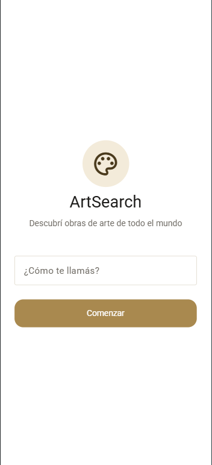
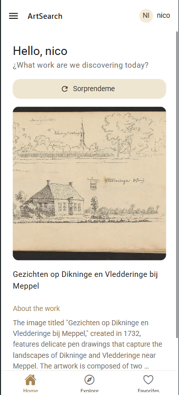
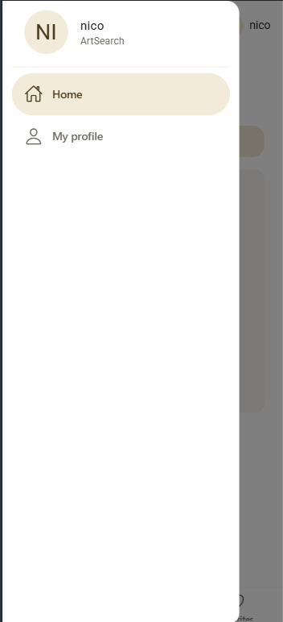
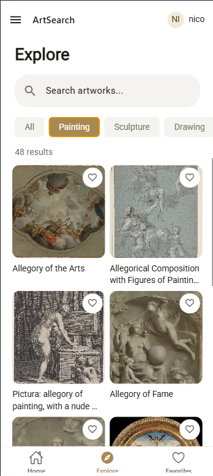
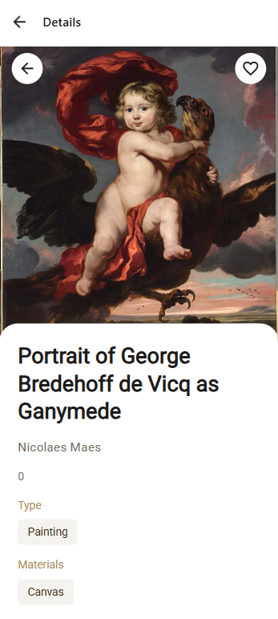
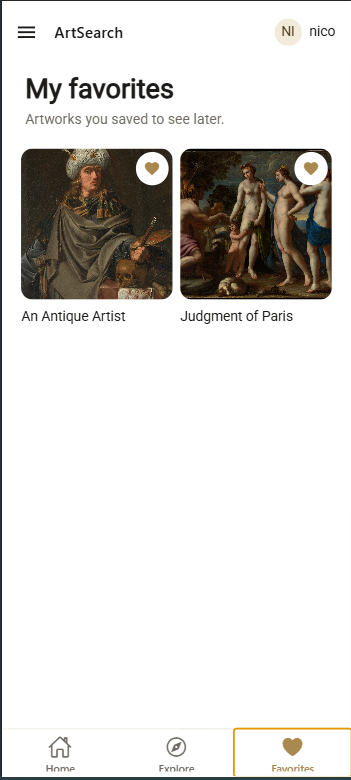
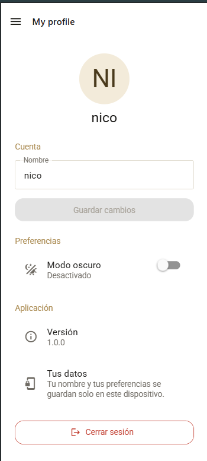
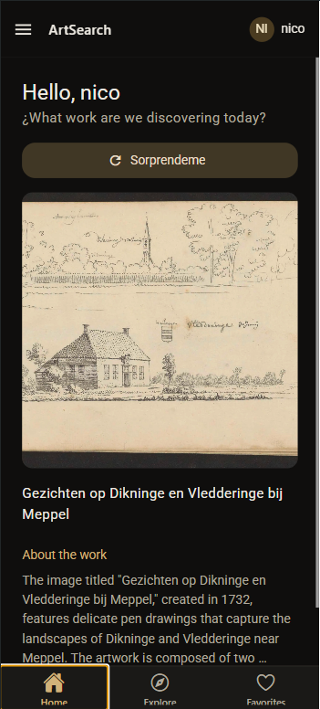
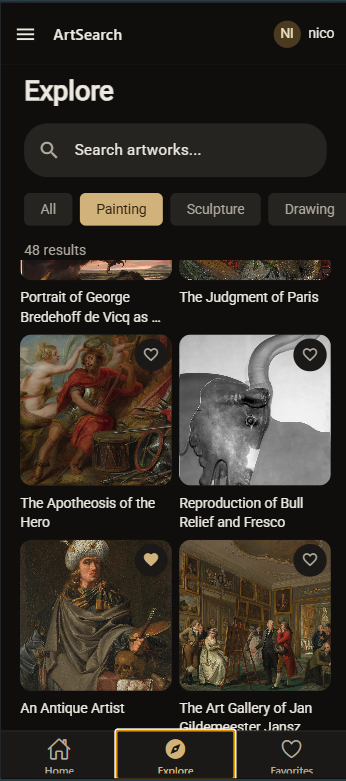
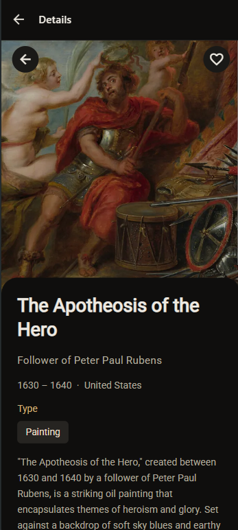

# ArtSearch

Aplicación móvil para **explorar obras de arte de todo el mundo**, desarrollada con **React Native + Expo (SDK 54) + TypeScript**.

Los datos provienen de la [Art Search API](https://artsearch.io/). El usuario ingresa su nombre, descubre una obra aleatoria, busca y filtra obras, mira el detalle de cada una y guarda sus favoritas en el dispositivo.

---

## Tabla de contenidos

1. [Funcionalidades](#funcionalidades)
2. [Capturas de pantalla](#capturas-de-pantalla)
3. [Tecnologías utilizadas](#tecnologías-utilizadas)
4. [Requisitos previos](#requisitos-previos)
5. [Instalación y ejecución](#instalación-y-ejecución)
6. [Configuración de la API](#configuración-de-la-api)
7. [Variables de entorno (.env)](#variables-de-entorno-env)
8. [Navegación](#navegación)
9. [Pantallas](#pantallas)
10. [Consumo de la API: hooks personalizados](#consumo-de-la-api-hooks-personalizados)
11. [Persistencia con AsyncStorage](#persistencia-con-asyncstorage)
12. [Theming y estilos reutilizables](#theming-y-estilos-reutilizables)

---

## Funcionalidades

- **Pantalla de bienvenida** que pide el nombre del usuario y lo guarda en el dispositivo. Mientras no haya un nombre guardado, no se puede acceder al resto de la app.
- **Inicio**: saludo personalizado y una **obra aleatoria** con imagen, título, origen, tipo y descripción. El botón *Sorprendeme* pide otra obra. La imagen se puede ver a **pantalla completa**.
- **Explorar**: buscador de texto, **chips de filtro** (tipo, material y técnica), contador de resultados y grilla de obras con **paginación** (de 10 en 10 mediante `offset`).
- **Favoritos**: cada tarjeta tiene un corazón para guardar la obra. Las obras guardadas se muestran en la pantalla Favoritos y **persisten** al cerrar la app.
- **Detalle de obra**: imagen grande, título, autor, años, origen, tipos, materiales y descripción completa. Se abre desde Explorar.
- **Perfil**: avatar con iniciales, edición del nombre, interruptor de **modo claro/oscuro**, versión de la app y cierre de sesión.
- **Tema claro y oscuro** con una paleta propia (dorado y crema).
- **Manejo de errores y estados vacíos**: carga, error con botón de reintento y listas vacías.

---

## Capturas de pantalla

> Las imágenes se guardan en la carpeta [`docs/screenshots/`](docs/screenshots). Para agregarlas, tomá las capturas desde el emulador o el celular, guardalas con estos nombres y se mostrarán acá automáticamente.

### Modo claro

| Bienvenida | Inicio | Menú lateral |
|:---:|:---:|:---:|
|  |  |  |

| Explorar | Detalle de obra | Favoritos |
|:---:|:---:|:---:|
|  |  |  |

| Perfil |
|:---:|
|  |

### Modo oscuro

| Inicio | Explorar | Detalle de obra |
|:---:|:---:|:---:|
|  |  |  |

---

## Tecnologías utilizadas

| Tecnología | Para qué se usa |
|---|---|
| [Expo](https://expo.dev/) **SDK 54** | Plataforma y herramientas para desarrollar y compilar la app |
| [React Native](https://reactnative.dev/) | Interfaz nativa multiplataforma |
| [TypeScript](https://www.typescriptlang.org/) | Tipado estático |
| [Expo Router](https://docs.expo.dev/router/introduction/) | Navegación basada en archivos (Stack, Tabs y Drawer) |
| [React Native Paper](https://callstack.github.io/react-native-paper/) | Componentes Material Design 3 y sistema de temas |
| [AsyncStorage](https://react-native-async-storage.github.io/async-storage/) | Persistencia local (sesión y favoritos) |
| [React Native Reanimated](https://docs.swmansion.com/react-native-reanimated/) | Animaciones y soporte del Drawer |
| [EAS Build](https://docs.expo.dev/build/introduction/) | Generación del APK |
| [Art Search API](https://artsearch.io/docs/) | Fuente de datos de las obras |

---

## Requisitos previos

- [Node.js](https://nodejs.org/) (versión LTS) y `npm`.
- La app **Expo Go** en el celular (versión compatible con SDK 54) o un emulador de Android/iOS.
- Una **API key** gratuita de Art Search (ver [Configuración de la API](#configuración-de-la-api)).
- Una cuenta de [Expo](https://expo.dev/) (solo si vas a generar el APK).

---

## Instalación y ejecución

```bash
# 1. Clonar el repositorio
git clone https://github.com/SilvaMauricioN/artgallery-react-native.git
cd artgallery-react-native

# 2. Instalar dependencias
npm install

# 3. Crear el archivo .env a partir del ejemplo
cp .env.example .env

# 4. Abrir .env y pegar tu API key (ver la sección siguiente)

# 5. Iniciar la app (la opción -c limpia la caché de Metro)
npx expo start -c
```

Después escaneá el código QR con **Expo Go** o presioná `a` (Android) / `i` (iOS) para abrir un emulador.

> **Importante:** cada vez que modifiques el archivo `.env`, reiniciá con `npx expo start -c`. Expo lee las variables solo al arrancar.

---

## Configuración de la API

La app consume la **[Art Search API](https://artsearch.io/docs/)**, que requiere una **API key**.

### Cómo obtener la API key

1. Entrá a la consola de Art Search: **<https://artsearch.io/console/>**.
2. Registrate con tu correo (el plan gratuito no requiere tarjeta).
3. Copiá la API key que aparece en tu consola.
4. Pegala en tu archivo `.env` (ver [Variables de entorno](#variables-de-entorno-env)).

### Límite del plan gratuito

> **La versión gratuita permite 50 requests por día.**

Una vez superado el límite, la API deja de responder hasta el día siguiente y la app muestra un mensaje de error con un botón *Try again*. Más información en la [documentación de cuotas](https://artsearch.io/docs/quotas-and-rate-limiting/) y en los [planes de pago](https://artsearch.io/pricing/).

Para cuidar la cuota, la app:

- **No busca en cada tecla**: la búsqueda se ejecuta al presionar *Enter* en el teclado.
- **Pagina de a 10 obras**: solo pide la página siguiente cuando el usuario llega al final de la lista.
- **Cancela las respuestas viejas**: si cambian los filtros mientras carga una búsqueda, descarta el resultado anterior.

Cada acción consume **1 request**: abrir Inicio, tocar *Sorprendeme*, buscar o filtrar, cargar la página siguiente y abrir el detalle de una obra.

### Endpoints utilizados

| Endpoint | Para qué se usa | Pantalla | Hook |
|---|---|---|---|
| `GET /artworks/random` | Obra aleatoria | Inicio | `useGetRandomArtwork` |
| `GET /artworks` | Búsqueda con filtros y paginación | Explorar | `useGetArtworks` |
| `GET /artworks/{id}` | Detalle completo de una obra | Detalle | `useGetArtwork` |

**URL base:** `https://api.artsearch.io`

**Parámetros de `GET /artworks` que usa la app:**

| Parámetro | Descripción |
|---|---|
| `query` | Texto de búsqueda. Si el usuario no escribe nada, la app envía `famous artworks` |
| `type` | Tipo de obra (`painting`, `sculpture`, `drawing`, `print`, `photograph`) |
| `material` | Material (`oil_paint`, `watercolor`, `bronze`, `marble`) |
| `technique` | Técnica (`etching`, `woodcut`) |
| `number` | Cantidad de obras por página (la app usa `10`) |
| `offset` | Posición desde la que se piden las obras (paginación) |

### Autenticación

La API key se envía en la URL con el parámetro `api-key`:

```
https://api.artsearch.io/artworks?api-key=TU_API_KEY&query=landscape&number=10&offset=0
```

### Formato de las respuestas

**Búsqueda** (`GET /artworks`):

```json
{
  "available": 993,
  "number": 10,
  "offset": 0,
  "artworks": [
    { "id": 25262216, "title": "Zittende jongeman met vilten hoed op", "image": "https://img.artsearch.io/artworks/..." }
  ]
}
```

**Detalle** (`GET /artworks/{id}`): además de `id`, `title` e `image`, puede incluir `start_date`, `end_date`, `author`, `origin`, `art_types`, `materials` y `description`. Todos esos campos son opcionales, por eso la app los maneja como tales.

---

## Variables de entorno (.env)

Hay que crear un archivo **`.env`** en la **raíz del proyecto** (al lado de `package.json`). El repositorio incluye un `.env.example` como plantilla.

```env
# URL base de la API
EXPO_PUBLIC_ARTSEARCH_API_URL=https://api.artsearch.io

# Tu API key personal (ver "Configuración de la API")
EXPO_PUBLIC_ARTSEARCH_KEY=tu_api_key_aqui
```

Reglas a tener en cuenta:

- Los nombres **deben empezar con `EXPO_PUBLIC_`**; si no, Expo no los expone al código.
- Se leen con el nombre completo y literal (`process.env.EXPO_PUBLIC_ARTSEARCH_KEY`). No funciona desestructurarlas ni armar el nombre dinámicamente.
- Sin comillas y sin espacios alrededor del `=`.
- El archivo `.env` **no se sube al repositorio** (está en `.gitignore`). Solo se versiona `.env.example`.
- Las variables `EXPO_PUBLIC_*` quedan **dentro del bundle** de la app, por lo que no son secretas. Para un proyecto académico alcanza, pero en producción la key debería estar en un servidor intermedio.

---

## Navegación

La app combina los tres tipos de navegación con **Expo Router**:

| Tipo | Dónde | Qué contiene |
|---|---|---|
| **Stack** | `app/_layout.tsx` | `welcome`, el Drawer y la pantalla de detalle `artwork/[id]` |
| **Drawer** | `app/(drawer)/_layout.tsx` | Inicio (las pestañas) y Mi perfil |
| **Tabs** | `app/(drawer)/(tabs)/_layout.tsx` | Inicio, Explorar y Favoritos |

### Protección de rutas

`app/_layout.tsx` usa `Stack.Protected` según el estado de la sesión:

- **Sin nombre guardado:** solo existe `welcome`.
- **Con nombre guardado:** se habilitan `(drawer)` y `artwork/[id]`.

Al guardar el nombre, la app pasa sola a la pantalla principal; al cerrar sesión desde Perfil, vuelve a `welcome`. Mientras se lee AsyncStorage se mantiene el splash para evitar parpadeos.

La pantalla de detalle solo se abre desde Explorar y se muestra encima del Drawer y las pestañas, para que la imagen ocupe todo el ancho.

---

## Pantallas

| Pantalla | Ruta | Qué hace | Endpoint |
|---|---|---|---|
| **Bienvenida** | `welcome` | Pide el nombre con validación (2 a 30 caracteres) y lo guarda | — |
| **Inicio** | `(tabs)/index` | Saludo, obra aleatoria, descripción con "Ver más" y visor a pantalla completa | `GET /artworks/random` |
| **Explorar** | `(tabs)/explore` | Búsqueda, chips, contador y grilla con scroll infinito | `GET /artworks` |
| **Detalle** | `artwork/[id]` | Información completa de la obra y botón de favorito | `GET /artworks/{id}` |
| **Favoritos** | `(tabs)/favorite` | Lista de obras guardadas; el corazón las quita | — (AsyncStorage) |
| **Perfil** | `(drawer)/profile` | Editar nombre, modo oscuro, versión y cerrar sesión | — |

---

## Consumo de la API: hooks personalizados

Toda la comunicación con la API está encapsulada en **hooks personalizados**, de modo que las pantallas solo reciben los datos y los estados. Todos devuelven la misma forma: `data`, `loading`, `error` y una función para reintentar.

| Hook | Descripción |
|---|---|
| `useGetRandomArtwork()` | Pide una obra aleatoria al montar. `refetch` pide otra |
| `useGetArtworks(query, filters)` | Busca obras de 10 en 10. Se vuelve a ejecutar solo si cambia el texto o un filtro. Devuelve `loadMore` (página siguiente), `refetch` (empezar de nuevo) y `retry` (repetir la petición fallida) |
| `useGetArtwork(id)` | Trae el detalle de una obra por id |

Detalles de implementación de `useGetArtworks`:

- La paginación usa `offset`: el siguiente pedido empieza donde terminó el anterior.
- Un contador de pedidos (`useRef`) descarta las respuestas viejas que llegan tarde.
- Se evitan obras repetidas al juntar páginas.
- `useCallback` mantiene estables las funciones del hook y `useMemo` calcula el conjunto de ids favoritos.

---

## Persistencia con AsyncStorage

El hook `useStoredState` (en `shared/`) funciona como un `useState` que **lee el valor guardado al montarse y lo guarda cada vez que cambia**. Además informa con `isReady` cuándo terminó de leer.

| Clave | Contenido | Lo usa |
|---|---|---|
| `@apiRest:session` | Nombre del usuario (la sesión) | `SessionProvider` (`UserContext.tsx`) |
| `@artapp/favorites` | Lista de obras favoritas (`id`, `title`, `image`) | `FavoritesProvider` (`FavoritesContext.tsx`) |

Los favoritos guardan solo los datos simples de la obra. Al abrir Favoritos no hace falta llamar a la API, por lo que no consume cuota.

---

## Theming y estilos reutilizables

- **Paleta propia** en `constants/theme.ts`, construida sobre Material Design 3 de React Native Paper, con dos versiones: `lightTheme` y `darkTheme`.
- **Colores propios** además de los de Material: `success`, `successDisabled`, `tabBar` y `onTabBar`, tipados en `AppTheme`.
- **`ThemeModeProvider`** (`ThemeContext.tsx`) guarda si el modo es oscuro y ofrece `toggleTheme`. El layout raíz pasa el tema correspondiente a `PaperProvider`, y todos los componentes lo toman automáticamente.
- **`useAppTheme()`** devuelve el tema activo tipado, para leer colores en estilos propios (`theme.colors.primary`, etc.). La regla del proyecto es **no escribir colores a mano** en los componentes.
- **`spacing`** define una escala de espacios (`xs`, `sm`, `md`, `lg`, `xl`) usada en todas las pantallas.
- El interruptor de modo oscuro está en la pantalla **Perfil**.

| Color | Modo claro | Modo oscuro |
|---|---|---|
| `primary` (dorado) | `#A9894F` | `#D1B27A` |
| `background` | `#FFFFFF` | `#0F0E0D` |
| `surface` | `#FFFFFF` | `#1A1917` |
| `surfaceVariant` | `#F5F3EF` | `#262421` |
| `tabBar` | `#C4A670` | `#B8985F` |

**Componentes reutilizables:** `ArtworkCard`, `FilterChips`, `StatusMessage`, `UserAvatar`, `UserHeader` y `DrawerContent`.

---

**Autor:** Silva Mauricio Nicolás R. 
